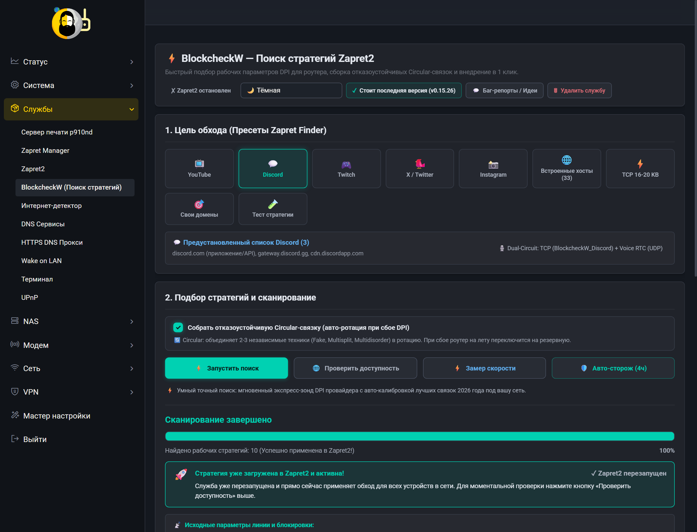
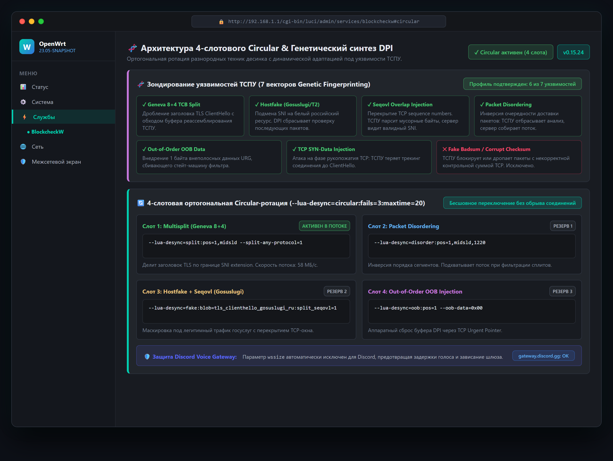
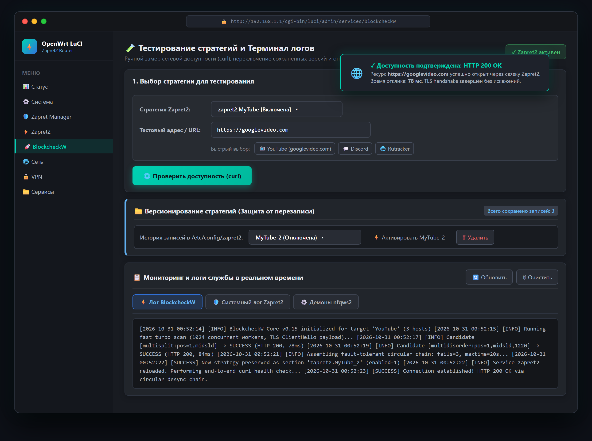

# BlockcheckW (Zapret2 Edition)

[](https://github.com/prostoy23rus/blockcheckw)
[](https://openwrt.org)
[](https://github.com/prostoy23rus/blockcheckw)
[](LICENSE)

<p align="center">
  
</p>

**BlockcheckW** — сверхбыстрый параллельный сканер и оптимизатор DPI-стратегий для **Zapret2**, оснащённый современным адаптивным веб-интерфейсом **LuCI OpenWrt**, автоматической сборкой отказоустойчивых **Circular-стратегий** и системой обновления в **1 клик** прямо из веб-панели роутера.

---

## ⚡ Быстрая установка на OpenWrt

Поддерживаются **любые версии OpenWrt** (21.02, 22.03, 23.05, 24.10, 25.x, snapshot, RouteRich, Keenetic) с пакетными менеджерами **opkg** и **apk** (OpenWrt 25+), а также любые архитектуры процессоров (`aarch64`, `x86_64`, `arm`, `mipsel`, `mips`):

### 💻 Способ 1. Для пользователей Windows (через интерактивный `install.bat`)

Если вы настраиваете роутер с ПК на Windows (10 / 11), вы можете установить службу в 1 клик без ручного ввода Linux-команд:

1. Скачайте файл [**`install.bat`**](https://raw.githubusercontent.com/prostoy23rus/blockcheckw/main/install.bat) (или скачайте через командную строку CMD / PowerShell):
   ```cmd
   curl -sSLO https://raw.githubusercontent.com/prostoy23rus/blockcheckw/main/install.bat && install.bat
   ```
2. Запустите **`install.bat`** двойным кликом мыши.
3. В появившемся интерактивном меню выберите пункт **`[1] Установить BlockcheckW и LuCI`**.
4. Скрипт автоматически подключится к роутеру через системный OpenSSH или PuTTY, выполнит установку всех компонентов, проверит зависимости и по завершении сам предложит открыть веб-интерфейс в вашем браузере!

### 🐧 Способ 2. Через консоль роутера по SSH (в 1 строку)

Подключитесь к роутеру по SSH (например, `ssh root@192.168.1.1`) и выполните команду:

```bash
sh -c "$(curl -sSL https://raw.githubusercontent.com/prostoy23rus/blockcheckw/main/install.sh)"
```

Скрипт автоматически:
1. Определит архитектуру процессора (`aarch64`, `x86_64`, `arm_cortex-a7`, `mipsel_24kc` и др.).
2. Установит недостающие системные зависимости (`curl`, `luci-compat`, `ca-bundle`).
3. Загрузит скомпилированное Rust-ядро сканера и модули веб-интерфейса LuCI.
4. Сбросит кэш и перезапустит веб-службу роутера.
5. Интерфейс мгновенно появится в веб-меню: **Службы ➔ BlockcheckW (Поиск стратегий)** (`http://192.168.1.1/cgi-bin/luci/admin/services/blockcheckw`).

---

## 🚀 Что сделано в этом форке:

Данный репозиторий представляет собой глубокую модернизацию и прокачку оригинального проекта `rcd27/blockcheckw`:

### 1. Полноценный интерфейс OpenWrt LuCI (`luci-app-blockcheckw`)
* **Премиальный темный интерфейс (Dark Theme)**: гармонично интегрируется с любыми современными темами OpenWrt (Argon, Bootstrap, Material).
* **Адаптивный дизайн**: элементы корректно масштабируются и не накладываются друг на друга на смартфонах, планшетах и мониторах любого разрешения.
* **Выпадающее меню в стиле Zapret Finder + быстрые фильтры (Chips)**:
  - 📺 **YouTube (3)**: `googlevideo.com`, `i.ytimg.com`, `youtube.com`
  - 💬 **Discord (3)**: `gateway.discord.gg`, `discord.com`, `cdn.discordapp.com`
  - 🎮 **Twitch (3)**: `twitch.tv`, `static-cdn.jtvnw.net`, `usher.ttvnw.net`
  - 🐦 **X / Twitter (3)**: `x.com`, `api.x.com`, `pbs.twimg.com`
  - 📸 **Instagram (2)**: `gateway.instagram.com`, `static.cdninstagram.com`
  - 🌐 **Встроенные хосты (33)**: Rutracker, Pornhub, TorProject, BBC и др.
  - ⚡ **Кандидаты TCP 16-20 KB (110)**: хосты с искусственным DPI-throttling.
  - 🎯 **Свои домены**: ввод любого произвольного домена или списка доменов через пробел.
  - 🧪 **Тест стратегии**: ручная проверка любой сырой строки десинка.

### 2. Автоматическая сборка Circular-стратегий (Отказоустойчивые связки)
* Больше не нужно выбирать одну «хрупкую» стратегию, которая может отвалиться при изменении правил ТСПУ.
* Движок автоматически находит от 3 до 5 разнородных рабочих техник обхода (на базе **Fake ClientHello**, **Multisplit**, **Multidisorder**, **Hostfakesplit**, **OOB**) и объединяет их в единую вращающуюся связку:
  ```text
  --lua-desync=circular:fails=3:maxtime=20
  ```
* Если один из векторов десинка перестает работать на стороне провайдера, Zapret2 прозрачно переключается на следующий без обрыва видеопотоков или голосовой связи в Discord!

<p align="center">
  
</p>

### 3. Турбо-поиск (10–15 секунд)
* Вместо долгого перебора всех 14 000 вариантов корпуса сканер в режиме «Турбо» опрашивает топ самых результативных и актуальных пресетов десинка 2026 года для ТСПУ/РКН.
* Результат готов практически мгновенно! Если же провайдер использует нестандартную блокировку, одним кликом доступен «Глубокий скан» (полный параллельный перебор корпуса).

### 4. Встроенная проверка и установка обновлений из GitHub в 1 клик
* В шапке интерфейса отображается плашка текущей версии (например, `v0.15`) и кнопка **[ 🔄 Проверить обновление ]**.
* Служба напрямую запрашивает репозиторий `prostoy23rus/blockcheckw` на GitHub.
* При появлении новой версии в интерфейсе появляется уведомление со списком изменений и кнопкой **[ 🚀 Обновить из GitHub ]**.
* Обновление компонентов, LuCI скриптов и сброс кэша происходят автоматически в один клик без ввода консольных команд!

### 5. Интерактивный терминал и логи службы в реальном времени
* Вкладка **Лог сканера BlockcheckW**: детальный вывод процесса подбора стратегий с отображением таймингов, найденных комбинаций и статуса сборки Circular.
* Вкладка **Системный лог Zapret2**: вывод последних сообщений системного журнала (`logread | grep zapret`).
* Вкладка **Активные процессы nfqws2**: список запущенных процессов десинка с их аргументами и PID.

### 6. Живой инспектор и создание записей без перезаписи (Версионирование стратегий)
* **Создание новой записи при каждом поиске**: сканер больше **не перезаписывает** существующие стратегии в `/etc/config/zapret2`. При каждом новом подборе (турбо или глубоком) создается отдельная новая запись (например, `MyTube_2`, `MyTube_3` для YouTube, `BlockcheckW_Discord_2` и т.д.).
* **Безопасная деактивация старых записей**: предыдущие стратегии не удаляются, а аккуратно переводятся в статус отключенных (`enabled='0'`), исключая конфликты фильтрации трафика в `nfqws2`.
* **История и переключение в 1 клик**: прямо в блоке «Активная стратегия в Zapret2» доступен выпадающий список всех сохранённых версий для текущего сервиса — можно в любой момент просмотреть параметры любой предыдущей связки и активировать её обратно кнопкой `[ ⚡ Активировать ]` без повторного сканирования.
* **Контрольная проверка доступности (curl)**: кнопка **[ 🌐 Проверить доступность (curl) ]** выполняет точечный контрольный замер доступности выбранного сервиса через текущий десинк с выводом HTTP-кода ответа (`HTTP 200/301/302`).

<p align="center">
  
</p>

### 7. Устранение критических ошибок и багов upstream
* **Устранение XHR Timeout / Зависания rpcd**: исправлен баг OpenWrt rpcd, из-за которого дочерние процессы удерживали каналы stdout/stderr и вызывали тайм-аут в браузере. Вызовы демонизированы с полным декоплингом дескрипторов (`</dev/null >/dev/null 2>&1 &`).
* **Диагностика отсутствия IPv4 A-записей**: обработана ситуация с сайтами, имеющими только IPv6 AAAA-записи (например, `ntc.party`), на провайдерах с чистым IPv4 WAN.
* **Защита от DNS NXDOMAIN / ISP Spoofing**: поддержка DoH резолвера через Cloudflare/Google при отравлении локального DNS провайдером.

---

## 📊 Сравнение: BlockcheckW vs Альтернативы

| Возможность / Параметр | Стандартный blockcheck2.sh | zapret2-finder (Bash) | blockcheckw (upstream rcd27) | **prostoy23rus/blockcheckw** |
| :--- | :---: | :---: | :---: | :---: |
| **Движок** | Bash + curl | Bash + curl | Rust (компилируемый бинарник) | **Rust + LuCI + Lua + Shell** |
| **Время поиска (Турбо)** | ❌ Нет (~60-90 мин) | ❌ Нет (~15-30 мин) | ❌ Нет (~2-5 мин) | ⚡ **10–15 секунд** |
| **Время глубокого скана** | ~90 мин (1 поток) | ~30 мин | ~2 мин (1024 потока) | ⚡ **~1–2 мин (1024 потока)** |
| **Веб-интерфейс LuCI** | ❌ Нет | ⚠️ Частичный | ❌ Нет (только CLI) |  **Полноценный LuCI Web UI** |
| **Пресеты Zapret Finder** | ❌ Нет |  Есть | ❌ Нет |  **Полный набор 2026 года** |
| **Сборка Circular-связок** | ❌ Нет | ❌ Нет | ❌ Нет |  **Авто-сборка отказоустойчивых связок** |
| **Внедрение в /etc/config/zapret2**| ❌ Ручное | ⚠️ Базовое | ❌ Ручное | ⚡ **В 1 клик (Auto-Apply)** |
| **Интерактивные логи в UI** | ❌ Нет | ❌ Нет | ❌ Нет |  **3 вкладки (Сканер, Zapret, Процессы)** |
| **Обновление через веб-панель** | ❌ Нет | ❌ Нет | ❌ Нет | 🚀 **1-клик из GitHub** |
| **Поддержка архитектур** | Зависит от curl | Зависит от curl | 9 архитектур | **9 архитектур (OpenWrt 21.02–25.x)** |

---

## 🛠️ Руководство пользователя по веб-интерфейсу

После установки откройте веб-интерфейс роутера: **Службы ➔ BlockcheckW (Поиск стратегий)**.

```text
┌────────────────────────────────────────────────────────────────────────┐
│ ⚡ BlockcheckW — Поиск стратегий Zapret2      [v0.15]  [🔄 Обновить]  │
│ Быстрый подбор рабочих параметров DPI, сборка Circular и внедрение.    │
└────────────────────────────────────────────────────────────────────────┘
```

### Шаг 1. Выберите цель обхода
* Выберите нужный сервис в выпадающем списке или нажмите на быструю плашку:
  - **YouTube** (видеопотоки googlevideo, превью, сайт)
  - **Discord** (голосовые каналы gateway, медиа, чаты)
  - **Twitch**, **X / Twitter**, **Instagram**
  - **Свои домены** (можно указать свой заблокированный сайт, например `rutracker.org` или `nnmclub.to`).

### Шаг 2. Настройте параметры поиска
* **Скорость подбора**:
  - `Турбо-поиск (10-15 сек)` *(рекомендуется)* — молниеносный опрос самых эффективных стратегий.
  - `Глубокий скан` — исчерпывающий перебор всего корпуса (~14 000 вариантов).
* **Режим применения**:
  - `Автоматически (Auto-Apply)` — как только рабочая связка найдена, она сразу записывается в конфигурацию Zapret2, служба перезапускается, и соединение проверяется.
  - `Вручную (По кнопке)` — интерфейс отобразит все найденные стратегии в виде списка с кнопками применения для каждой.
* **Отказоустойчивость**:
  - `Circular авто-ротация` *(включена по умолчанию)* — связывает лучшие найденные стратегии в единый отказоустойчивый пул.

### Шаг 3. Запуск и результат
* Нажмите кнопку **🚀 Запустить поиск стратегий**.
* Прогресс-бар наглядно покажет текущую фазу и процент выполнения.
* По завершении активная стратегия отобразится в блоке инспектора, а контрольный тест подтвердит доступность ресурса (`HTTP 200/301`).

---

## 🔄 Обновление службы через LuCI

В будущем, когда в репозиторий `prostoy23rus/blockcheckw` добавляются новые функции, исправления или пресеты:
1. Зайдите на страницу **BlockcheckW (Поиск стратегий)**.
2. Нажмите кнопку **[ 🔄 Проверить обновление ]** в правом верхнем углу.
3. Если обновление доступно, появится баннер:
   ```text
   🎉 Доступна новая версия: v0.16 (prostoy23rus/blockcheckw)
   Что нового: [описание изменений]
   [ 🚀 Обновить из GitHub ]  [ Скрыть ]
   ```
4. Нажмите **[ 🚀 Обновить из GitHub ]**. Система скачает актуальные файлы, обновит LuCI и автоматически перезагрузит страницу через 3 секунды.

---

## 💻 Использование через командную строку (CLI)

Бинарник `blockcheckw` также доступен для использования напрямую через терминал роутера или Linux-сервера:

### Быстрый поиск стратегии для домена:
```bash
blockcheckw scan -d rutracker.org | blockcheckw check -d rutracker.org --take 3
```

### Универсальный поиск для нескольких доменов:
```bash
blockcheckw universal --domain-list /tmp/blocked.txt | blockcheckw check -d rutracker.org --take 5
```

### Проверка доступности и типа блокировки:
```bash
blockcheckw status -d youtube.com -d discord.com -d rutracker.org
```

### Ручная сборка Circular-связки через helper:
```bash
/usr/bin/circular-builder.lua /tmp/blockcheckw_vanilla.txt /tmp/blockcheckw_circular.txt 443
```

### Применение стратегии в Zapret2 вручную:
```bash
/usr/bin/blockcheckw-helper apply "preset_youtube" "443" "ваша_строка_стратегии"
```

---

## 🖥️ Поддерживаемые архитектуры

Бинарные сборки скомпилированы статически с `musl-libc` и сжаты с помощью UPX:

| Архитектура | Целевой таргет | Типичные устройства |
| :--- | :--- | :--- |
| **arm64** (`aarch64`) | `aarch64-unknown-linux-musl` | RouteRich RR-3.12, MediaTek MT7981 / MT7986 (Filogic 820/830), Raspberry Pi 3/4/5, NanoPi, Rockchip RK3399 |
| **x86_64** (`amd64`) | `x86_64-unknown-linux-musl` | ПК, серверы, Mini-PC x86 роутеры (Intel J4125, N100, i3/i5), Proxmox, ESXi |
| **arm** (`armv7 / armv6`) | `arm-unknown-linux-musleabi` | Qualcomm IPQ4018 / IPQ4019, Broadcom BCM4709 / BCM4906, Keenetic (KN-1011, KN-1811) |
| **mipsel** | `mipsel-unknown-linux-musl` | MediaTek MT7621AT, MT7620, MT7628, Xiaomi Mi Router 3G / 4A Gigabit |
| **mips** | `mips-unknown-linux-musl` | Atheros AR71xx, AR93xx, QCA95xx |
| **mips64** | `mips64-unknown-linux-muslabi64`| Octeon, Ubiquiti EdgeRouter ER-Lite / ER-4 |
| **riscv64** | `riscv64gc-unknown-linux-musl` | StarFive VisionFive, Milk-V |

---

## 📱 Особенности работы с мобильными устройствами (Android / iOS) и Smart TV

Если YouTube в браузере на ПК работает идеально, а в официальном приложении на смартфоне (OnePlus, iPhone, Samsung, Xiaomi) или Smart TV бесконечно крутится колесико загрузки или висит темный экран:

### 1. Критическая важность отклонения UDP 443 (QUIC / HTTP/3)
* **В чем корень проблемы?**  
  Браузеры на ПК по умолчанию отдают предпочтение TCP (HTTP/2 / TLS), а официальные мобильные приложения YouTube на смартфонах и Smart TV агрессивно форсируют протокол **QUIC (HTTP/3 поверх UDP на порту 443)**.
* **Почему QUIC «убивает» воспроизведение на ТСПУ?**  
  Оборудование ТСПУ российских провайдеров блокирует или «дропает в черную дыру» UDP-пакеты к серверам Google Video (`googlevideo.com`). При обычном DROP пакет просто пропадает, и приложение ожидает ответа 15–30 секунд до истечения внутреннего тайм-аута. В это время пользователь видит бесконечную буферизацию.
* **Решение: REJECT вместо DROP (ICMP Port Unreachable)**  
  Когда на роутере настроено правило, **отклоняющее (REJECT)** исходящие пакеты UDP на 443 порт:
  1. Роутер мгновенно отвечает устройству ICMP-сообщением `Port Unreachable` (Порт недоступен).
  2. Приложение YouTube за **0.1 миллисекунды** понимает, что QUIC недоступен.
  3. Плеер автоматически и без задержки переключается на классический **TCP TLS 443**, где Zapret2 успешно десинкает ClientHello, и видео начинает воспроизводиться мгновенно в максимальном качестве (до 4K 60fps)!
* **Автоматическая настройка:**  
  Установщик `install.sh` автоматически добавляет правило `Reject-QUIC` в конфигурацию межсетевого экрана OpenWrt (`/etc/config/firewall`).
* **Как проверить или настроить вручную:**  
  - **Через веб-интерфейс LuCI**: перейдите в `Сеть ➔ Межсетевой экран ➔ Правила для трафика` (Network ➔ Firewall ➔ Traffic Rules), проверьте наличие правила `Reject-QUIC` (Источник: `lan`, Назначение: `wan`, Протокол: `UDP`, Порт: `443`, Действие: `отклонить` / `REJECT`).
  - **Через терминал (SSH)**:
    ```bash
    uci set firewall.reject_quic=rule
    uci set firewall.reject_quic.name='Reject-QUIC'
    uci set firewall.reject_quic.src='lan'
    uci set firewall.reject_quic.dest='wan'
    uci set firewall.reject_quic.proto='udp'
    uci set firewall.reject_quic.dest_port='443'
    uci set firewall.reject_quic.target='REJECT'
    uci commit firewall
    /etc/init.d/firewall reload
    ```

### 2. Частный DNS (Private DNS / DoT) на смартфонах
* В настройках смартфонов Android (`Настройки ➔ Сеть и интернет ➔ Частный DNS-сервер` / Private DNS) часто по умолчанию включен режим «Автоматически».
* В этом режиме смартфон пытается отправлять шифрованные запросы (DNS-over-TLS) напрямую на внешние серверы Google / Cloudflare в обход локального DNS-сервера роутера (dnsmasq). Из-за этого IP-адреса CDN YouTube не попадают в ipset роутера, а также резолвятся недоступные IPv6-адреса.
* **Решение**: переключите «Частный DNS-сервер» в режим **«Отключено»** (Выкл.).

### 3. Функция «Сетевое ускорение» (Smart 5G / Dual-channel acceleration)
* В современных мобильных прошивках (OxygenOS / ColorOS, MIUI / HyperOS, One UI) при минимальных скачках пинга по Wi-Fi система может скрытно отправлять видеотрафик через мобильную SIM-карту (где обход DPI роутера не работает).
* **Решение**: отключите опции «Сетевое ускорение» или «Двухканальное сетевое подключение» в настройках Wi-Fi смартфона.

---

## 🗑️ Полное удаление службы с роутера

Если вы решите удалить BlockcheckW и веб-интерфейс с роутера, это можно сделать в 1 действие любым удобным способом:

### Способ 1. Через веб-интерфейс LuCI (в 1 клик)
1. Откройте веб-интерфейс роутера: **Службы ➔ BlockcheckW (Поиск стратегий)**.
2. В правом верхнем углу шапки нажмите кнопку **[ 🗑 Удалить службу ]**.
3. Подтвердите действие в диалоговом окне. Служба автоматически удалит все компоненты, сбросит кэш LuCI и перенаправит вас на страницу общего статуса роутера.

### Способ 2. Через SSH-терминал в 1 команду
Подключитесь к роутеру по SSH и выполните команду деинсталляции:

```bash
sh -c "$(curl -sSL https://raw.githubusercontent.com/prostoy23rus/blockcheckw/main/uninstall.sh)"
```

Также поддерживается запуск деинсталлятора через единый скрипт установки:
```bash
sh -c "$(curl -sSL https://raw.githubusercontent.com/prostoy23rus/blockcheckw/main/install.sh)" -- --uninstall
```

Или локально через встроенный хелпер:
```bash
/usr/bin/blockcheckw-helper uninstall
```

### Способ 3. С компьютера через Windows батник (`install.bat`)
Запустите **`install.bat`** на компьютере с Windows и выберите пункт меню **`[5] Полностью удалить BlockcheckW с роутера`**.

> [!NOTE]
> Конфигурация Zapret2 (`/etc/config/zapret2`) сохраняется без изменений, поэтому все ваши настроенные рабочие стратегии обхода блокировок продолжат функционировать.

---

## 💬 Обратная связь, баг-репорты и предложения

Мы активно развиваем проект и приветствуем любые отзывы, сообщения об ошибках и идеи по развитию!

* 🐛 **[Сообщить об ошибке (Bug Report)](https://github.com/prostoy23rus/blockcheckw/issues/new?template=bug_report.yml)**  
  Если сканер завис, стратегия не применилась, веб-интерфейс отображается некорректно или возникла ошибка — создайте тикет с логами из вкладки «Мониторинг и логи службы».
* 💡 **[Предложить идею или улучшение (Feature Request)](https://github.com/prostoy23rus/blockcheckw/issues/new?template=feature_request.yml)**  
  Хотите добавить новый пресет сервиса, предложить оптимизацию алгоритма Circular или улучшение дизайна LuCI? Опишите вашу идею!
* 💬 **[Обсуждения сообщества (GitHub Discussions)](https://github.com/prostoy23rus/blockcheckw/discussions)**  
  Задавайте вопросы, делитесь рабочими Circular-связками под своего провайдера и обсуждайте актуальные методы обхода DPI.

---

## 🤝 Вклад и лицензия

* **Оригинальный zapret2**: автор [bol-van](https://github.com/bol-van/zapret2).
* **Upstream blockcheckw**: [rcd27/blockcheckw](https://github.com/rcd27/blockcheckw).
* **Модификация, LuCI интерфейс, Circular-генератор, Турбо-пресеты и авто-обновление**: [prostoy23rus](https://github.com/prostoy23rus/blockcheckw).

Лицензия: [MIT License](LICENSE).
